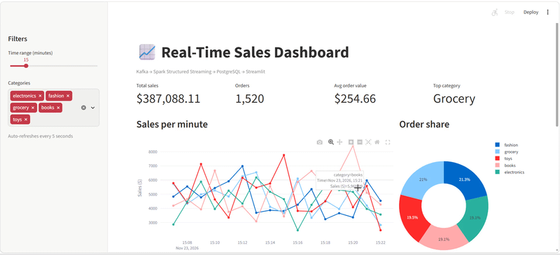

# Real-Time Sales Streaming Pipeline

An end-to-end real-time data pipeline that generates e-commerce orders, streams them through Kafka, aggregates them per minute with Spark Structured Streaming, stores results in PostgreSQL, and visualizes them on a live dashboard.



## Architecture

```
Python Producer → Kafka → Spark Structured Streaming → PostgreSQL → Streamlit Dashboard
 (fake orders)   (orders topic)  (clean + 1-min windows)   (storage)     (live charts)
```

## Tech Stack

- **Apache Kafka**: message broker (KRaft mode, 3 partitions)
- **Apache Spark 3.5 (Structured Streaming)**: windowed aggregation
- **PostgreSQL 16**: serving storage
- **Streamlit + Plotly**: live dashboard
- **Docker Compose**: infrastructure
- **Python**: producer (confluent-kafka, Faker)

## Project Structure

```
├── docker-compose.yml
├── requirements.txt
├── producer/producer.py
├── spark_jobs/stream_processor.py
├── dashboard/app.py
└── docs/
```

## How to Run

**Prerequisites:** Docker Desktop, Python 3.10+

```powershell
# 1. Install dependencies
python -m venv .venv
.venv\Scripts\activate
pip install -r requirements.txt

# 2. Start Kafka and Postgres
docker compose up -d

# 3. Create the Kafka topic
docker exec -it realtime_streaming_pipeline-kafka-1 /opt/kafka/bin/kafka-topics.sh --create --topic orders --bootstrap-server localhost:9092 --partitions 3 --replication-factor 1

# 4. Create the table
docker exec -it realtime_streaming_pipeline-postgres-1 psql -U de_user -d sales_db -c "CREATE TABLE IF NOT EXISTS sales_by_minute (window_start TIMESTAMP, window_end TIMESTAMP, category TEXT, total_sales DOUBLE PRECISION, order_count BIGINT);"

# 5. Start the Spark job (Terminal 1)
docker run --rm -it --user root --network realtime_streaming_pipeline_default -v ${PWD}/spark_jobs:/app -v ${PWD}/checkpoints:/checkpoints apache/spark:3.5.1 /opt/spark/bin/spark-submit --packages org.apache.spark:spark-sql-kafka-0-10_2.12:3.5.1,org.postgresql:postgresql:42.7.3 /app/stream_processor.py

# 6. Start the producer (Terminal 2)
python producer\producer.py

# 7. Start the dashboard (Terminal 3)
streamlit run dashboard\app.py
```

Dashboard: http://localhost:8501

Note: Postgres is exposed on host port **5433** (container port 5432) to avoid conflicts with a local PostgreSQL install.

## Design Decisions

- **Kafka** decouples the producer from processing and lets the pipeline replay and scale via partitions.
- **Event-time windows with a 2-minute watermark** handle late data and let Spark clean up state.
- **Deduplication** on `order_id` (inside the watermark) makes the pipeline safe against duplicate events.
- **Checkpointing** lets the Spark job recover after a restart.
- **Update output mode** writes a row each time a window changes. The dashboard keeps the row with the highest `order_count` per window and category.
- **Two Kafka listeners** (localhost for host tools, `kafka:29092` for containers).

## Known Limitations

- Update mode appends multiple rows per window; an upsert (`ON CONFLICT`) would be cleaner.
- Single Kafka broker, no replication.
- Credentials are hardcoded for local use; production would use environment variables or a secrets manager.

## Future Improvements

- Run the Spark job inside `docker-compose`
- Dead-letter topic for malformed records
- Replace fake data with a real API (e.g. Binance or Wikipedia streams)
- Unit tests and a GitHub Actions lint workflow
- Raw data lake layer in Parquet